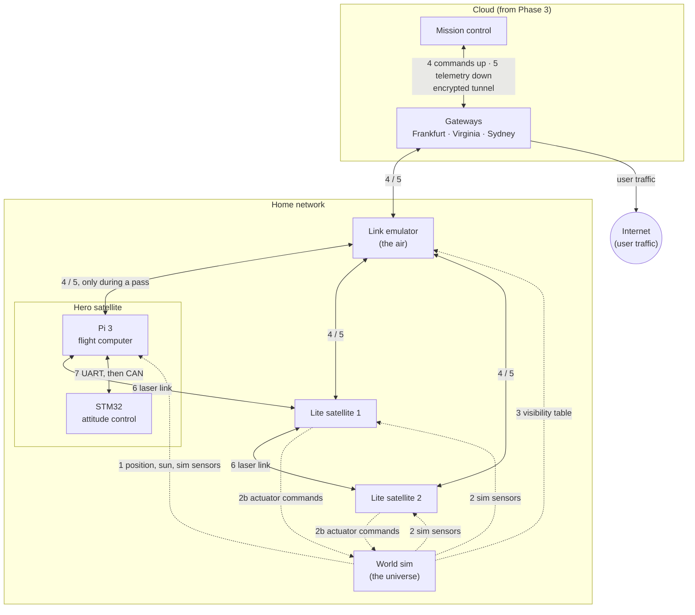

# Concept of Operations

**Status:** draft v0.2 (2026-11-27)

## 1. Mission

A scaled-down LEO broadband constellation testbed, inspired by public descriptions of Starlink. Three satellites fly one behind another in a single ~550 km orbital plane, linked by laser inter-satellite links (ISLs), with a network of ground gateways around the world and a separate mission control. Each satellite serves user terminals on the ground. It routes their traffic to a gateway directly, or through neighboring satellites when no gateway is in view.

In the lab, a laptop runs the world simulator and link emulator. Mission control and the gateways start on the laptop and move to cloud servers in Phase 3 (see section 4). One "hero" satellite is a Raspberry Pi 3 flight computer plus an STM32 attitude controller with real sensors and a reaction wheel. Two "lite" satellites are Raspberry Pi Zero 2 W boards running the same flight software, with simulated attitude control. Until Phase 8 they run as programs on the laptop.

### Why 550 km

- **Low latency:** about 2 ms one way, versus about 120 ms from geostationary orbit.
- **Debris self-cleanup:** residual drag brings a dead satellite down within about 5 years.
- **Link margin:** about 65 times closer than GEO means roughly 4,000 times less signal loss. That margin buys smaller antennas, lower transmit power, or more data rate.
- **The cost:** each satellite covers only a small area, so coverage needs many satellites.

### Key numbers

| Parameter | Value |
| --- | --- |
| Altitude | ~550 km |
| Orbital period | ~95 min (~15 orbits per day) |
| Eclipse per orbit | up to ~35 min (varies by season) |
| Usable gateway pass | ~4 min at best (above ~25° elevation); ~10 min horizon to horizon |
| Battery depth of discharge, nominal | 20–30% per orbit (stays above ~70–80% charge) |
| Ground track shift per orbit | ~24° west (Earth rotation) |

## 2. A day in the life of Satellite 1 (one orbit)

| Time | Event | What the satellite does | Subsystems involved |
| --- | --- | --- | --- |
| T+0 | Leaves eclipse over the Pacific | Battery at ~75%, its lowest point of the orbit. Points solar panels at the sun and recharges. No gateway in view. | Power, attitude control |
| T+5 | Over the ocean, serving ships and aircraft | No gateway in view, so user traffic is routed over ISLs to the neighbor (ahead or behind) with the best path to a gateway. Routing uses a contact plan: orbits are predictable, so the satellite knows hours ahead which neighbor will see a gateway, and when. | Comms, C&DH |
| T+20 | Gateway pass over Texas (~4 min) | The ground uploads the next stored schedule and contact plan (sometimes a software update). The satellite downlinks telemetry recorded since the last pass. Day to day, the satellite runs on its stored schedule, not on live commands. | Comms, C&DH |
| T+40 | Conjunction warning from the ground | The satellite assesses collision probability (most warnings are false alarms). If it's above the threshold, it plans a small burn hours ahead, because electric thrusters are weak. Attitude control points the thruster, and power must afford the thruster's draw. | Propulsion, attitude control, power |
| T+60 | Enters eclipse | Runs on battery. Heaters keep components above their minimum temperatures without draining the battery: on below one threshold, off above a slightly higher one (hysteresis). | Power, thermal |
| T+80 | Reaction wheel overcurrent | FDIR responds in proportion. **Detect:** current over limit for longer than a set time. **Isolate:** turn the wheel off. **Recover:** switch to the spare wheel, or fall back to magnetorquers for rough pointing. Safe mode only if pointing can't be held. Report the event right away through a neighbor if an ISL is up. Keep it stored, and resend at the next direct pass until acknowledged. | Attitude control, C&DH, comms |
| T+95 | Back to start | Never the same orbit twice: Earth has turned ~24°, so different gateways and users are in view. |  |

### Design principle: design for the worst-case link

The flight software assumes there's no link until the next direct pass. Events are stored, sent in priority order when any link is up, and kept until acknowledged. ISLs and relays are extra paths that sometimes exist. This keeps the bus software valid even for a single satellite with no neighbors.

## 3. Modes

The satellite is always in exactly one mode.

| Mode | Purpose | Enters when | Leaves when |
| --- | --- | --- | --- |
| Launch / deployed | Minimal power on the launch vehicle; boot after separation | Power-on | → Detumble, 90–120 s after separation is detected. → Safe, on low battery after separation |
| Detumble | Slow the random spin after separation using magnetorquers | After Launch, on timer | → Commissioning, once body rate stays < 0.5°/s for 5 min. → Safe, on low battery |
| Commissioning | Check out each subsystem with the ground | Detumble complete (then waits for first pass) | → Nominal, on authenticated ground sign-off only. → Safe, on a failed check or fault |
| Nominal | Serve users, route traffic, keep orbit | Ground sign-off from Commissioning or Safe | → Safe, on a fault it can't fix itself. → Collision Avoidance, on a threat. → Deorbit, on ground command only |
| Collision Avoidance | Pause normal work to point and fire thrusters | Collision probability above the entry threshold (ground-configurable) | → Nominal, when the recomputed probability is below the exit threshold or closest approach has passed. → Safe, on a fault mid-burn |
| Safe | Panels to sun, nonessentials off, wait for ground | Battery < 40%, no ground contact for 24 h, repeated computer resets, or an unrecoverable fault | → Nominal, on authenticated ground command only (even if the fault clears) |
| Deorbit | End of life: lower the orbit until re-entry | Two-step authenticated Arm, then Execute | None (one-way). On a propulsion, attitude or power fault, pauses the burn inside Deorbit, reports its new orbit, and resumes only on ground command |

### Autonomy rule

The satellite may move itself **toward safety** (into Safe or Collision Avoidance) on its own. Moves **toward risk or permanence** (out of Safe, into Nominal, into Deorbit) require an authenticated ground command.

### Faults during deorbit

A burn that stops halfway leaves the satellite in a lower, oval orbit that crosses altitudes where other spacecraft fly (the ISS is around 420 km), and tracking predictions no longer match it. Deorbit has no way back to Nominal, so it has its own paused state:
1. Stop the burn and hold a stable attitude.
2. Report actual position, velocity and predicted orbit on the next available link, so the ground can share it with space-tracking organizations.
3. Keep collision avoidance active if the thrusters still work.
4. Resume only on ground command. If propulsion is dead, drag completes the deorbit, faster now from the lower orbit.

### Arm / execute

Irreversible actions use two steps. **Arm** puts the satellite in a ready state and starts a 10-minute timer. **Execute** is accepted only while armed. The satellite disarms on its own when the timer expires, and the ground can send Disarm at any time. One corrupted packet or operator slip can't trigger the action.

## 4. Architecture

Solid arrows exist on a real mission. Dotted arrows exist only because the environment is simulated.

### Components

| Component | Role | Runs on |
| --- | --- | --- |
| World sim | The "universe": orbits, sun and eclipse, gateway visibility, simulated sensors and actuators | Laptop (home) |
| Link emulator | The "air": carries every ground radio link and decides whether each packet is delivered | Laptop (home) |
| Mission control | Operators: predicts passes, schedules commands, receives telemetry | Laptop, then a cloud server from Phase 3 |
| Gateways | Ground antennas at a configurable list of locations (for example Texas, Washington, Frankfurt, Sydney) | Laptop, then cloud servers in 2–3 regions from Phase 3, plus one local gateway for precise timing tests |
| Hero satellite | Pi 3 flight computer; STM32 attitude controller with real sensors and reaction wheel added in Phases 5–9 | Desk (home) |
| Lite satellites 1, 2 | Same flight software, simulated attitude control | Laptop programs, then Pi Zero 2 W from Phase 8 |

### Interfaces

Solid = exists on a real mission. Dashed (sim only) = exists only because the environment is simulated.

| # | From → To | What | Rate | Over | Type |
| --- | --- | --- | --- | --- | --- |
| 1 | World sim → hero satellite | Position, sun direction, simulated sensor values for anything not yet real | 1 Hz | UDP, local network | Sim only |
| 2 | World sim → lite satellites | Position, sun direction, simulated gyro rates and magnetometer readings | 10 Hz | UDP, local | Sim only |
| 2b | Lite satellites → world sim | Actuator commands (wheel speeds, magnetorquer currents); closes the simulation loop | 10 Hz | UDP, local | Sim only |
| 3 | World sim → link emulator | Visibility table: gateway, satellite, up/down, elevation | 1 Hz | UDP, local | Sim only |
| 4 | Mission control → gateway → link emulator → satellite | Stored schedules, contact plans, conjunction warnings, maneuver commands, immediate commands (mode changes, arm/execute deorbit, cut link, settings), acknowledgments of received telemetry, time corrections, software updates | Bursts during passes | CCSDS telecommands over UDP, encrypted and authenticated | Flight |
| 5 | Satellite → link emulator → gateway → mission control | Telemetry, sent in this priority order: events (e.g. entered Safe mode), command reports (accepted / executed / rejected), live health, stored health since last pass, orbit reports, acknowledgments, files. User traffic leaves at the gateway for the internet and never reaches mission control | Live health 1 Hz during passes; stored data in a burst | CCSDS telemetry over UDP, encrypted | Flight |
| 6 | Satellite ↔ satellite (ISL) | User traffic, relayed telemetry and commands, position for laser pointing, heartbeats, time sync | Heartbeat and position ~1 Hz; traffic continuous | UDP with tc netem delay; always up unless cut | Flight |
| 7a | Hero Pi 3 → STM32 | Attitude mode (detumble, sun-point, target-point), target direction, sun direction from the sim (no real sun sensor yet), settings, heartbeat | On change, heartbeat 1 Hz | UART (Phase 5), then CAN (Phase 8) | Flight |
| 7b | STM32 → hero Pi 3 | Attitude estimate, rotation rates, wheel speed and current, faults, heartbeat | 10 Hz | UART, then CAN | Flight |

### Design decisions

- **Truth versus knowledge.** The world sim and link emulator hold the truth. Mission control and flight software only hold knowledge: what telemetry and predictions tell them. Mission control predicts passes from the orbit the satellite reports and never reads the world sim, so its predictions can be wrong, as a real operator's can (stale orbit, unreported burn, broken antenna, clock drift). Those mismatches are part of what gets tested.
- **The STM32 runs the attitude control loop itself** (50–100 Hz on FreeRTOS). The Pi only sets the goal and reads reports. That keeps loop timing steady, keeps the Pi-to-STM32 link light, and keeps the satellite stable if the Pi crashes.
- **Hardware abstraction.** Flight software reads sensors and drives actuators through one interface, with a real driver or a simulator behind it, and can't tell which.
- **All ground radio traffic goes through the link emulator.** Gateways never reach satellites directly. For each packet, the emulator checks that the gateway can see the satellite right now, applies realistic loss, and enforces the link's data rate. Otherwise the internet would let any gateway reach any satellite at any time.
- **Inter-satellite links are always up.** All three satellites share one orbital plane, so neighbors stay at nearly fixed spacing. Linux `tc netem` adds delay and loss, and a "cut link" command breaks a link on purpose to test rerouting.
- **What runs where.** Things connected by the internet in reality (mission control and gateways) are distributed for real, through an encrypted WireGuard or Tailscale tunnel to home. Things connected by radio or laser (gateways to satellites, satellites to each other) are emulated at home.

## 5. Open questions

- Exact collision probability thresholds (entry ~1 in 10,000, exit ~1 in 100,000 as starting values).
- Telemetry priority levels for event reports carried over ISLs versus customer traffic.
